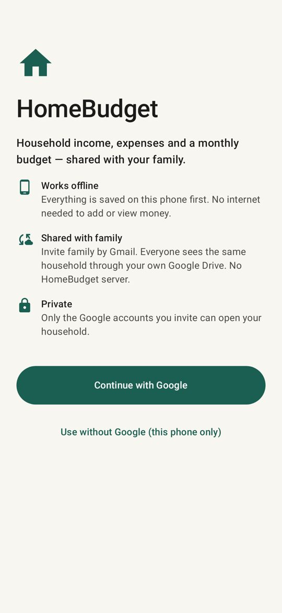
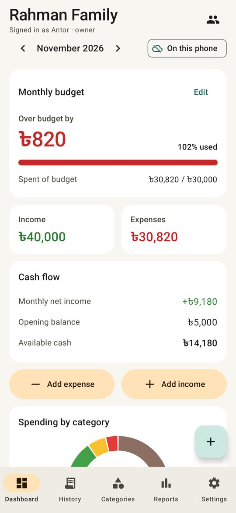
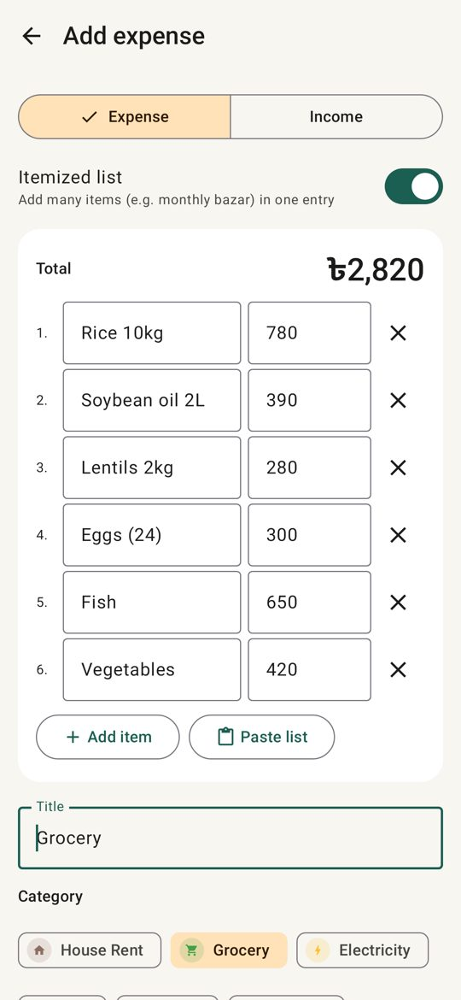
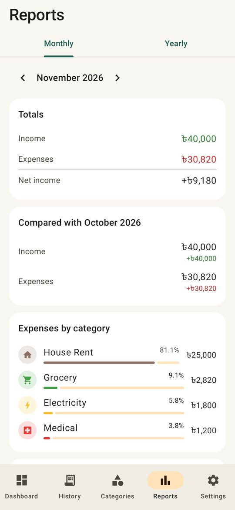
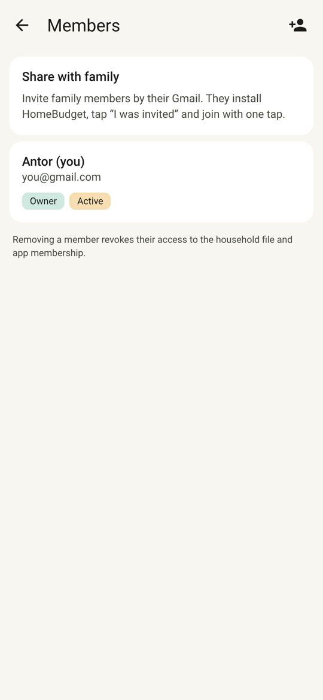
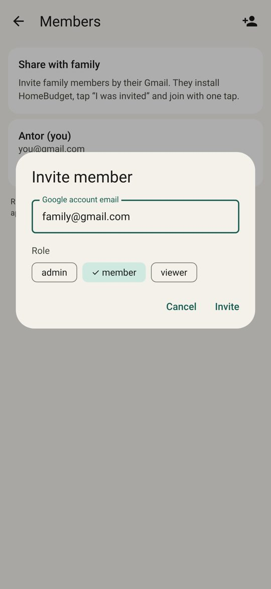
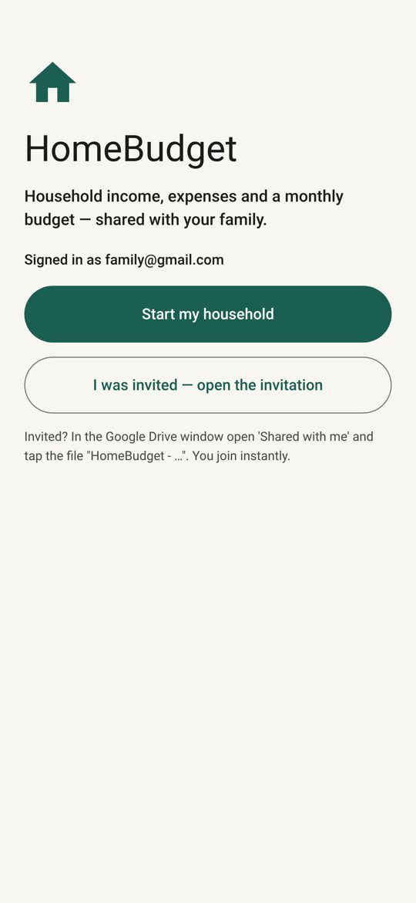
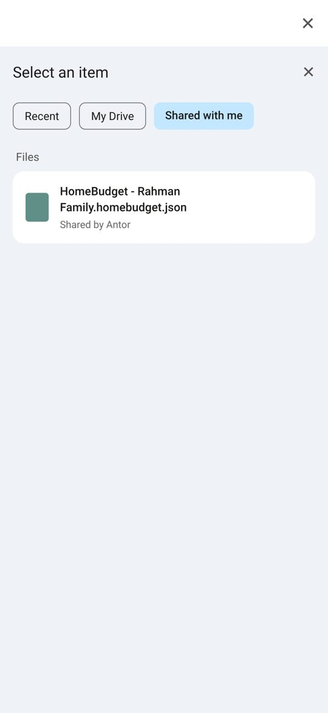

# HomeBudget — সংসারের হিসাব, পুরো পরিবারের জন্য

HomeBudget একটা Android অ্যাপ। এতে সংসারের আয়, খরচ আর মাসের বাজেটের হিসাব রাখা যায় (টাকা ৳)।
ইন্টারনেট ছাড়াও চলে। পরিবারের সবাই নিজের Gmail দিয়ে একই হিসাব দেখতে ও লিখতে পারে।
সব ডেটা থাকে মালিকের নিজের Google Drive-এ, encrypted অবস্থায়। কোনো আলাদা সার্ভার, বিজ্ঞাপন বা ট্র্যাকিং নেই।

<p>




</p>

## ⬇️ ডাউনলোড

**[সর্বশেষ APK ডাউনলোড করুন (Releases)](https://github.com/antor9732/HomeBudget/releases/latest)**: `HomeBudget-x.y.z.apk` ফাইলটা নামান।

একই পেজে দুটো বাংলা ভিডিও আছে:
- `HomeBudget-invite-join.mp4`: সদস্য যোগ করা আর Join করা (১ মিনিট ২২ সেকেন্ড)
- `HomeBudget-tutorial.mp4`: পুরো অ্যাপের পরিচিতি (২ মিনিট)

> প্রয়োজন: Android 8.0 বা তার পরের ভার্সন, আর একটা Gmail অ্যাকাউন্ট (শেয়ার করতে চাইলে)।

---

## ১. ইনস্টল করা

1. ফোনে ওপরের লিংক থেকে `HomeBudget-x.y.z.apk` ডাউনলোড করুন।
2. ডাউনলোড শেষ হলে ফাইলটায় ট্যাপ করুন।
3. **"Install unknown apps"** বা **"অজানা উৎস"**-এর অনুমতি চাইলে **Settings → Allow from this source** চালু করুন, তারপর ফিরে আসুন।
4. **Install** চাপুন।

> Play Protect "unrecognized app" সতর্কবার্তা দেখাতে পারে। কারণ অ্যাপটা এখনো Play Store-এ নেই।
> **More details → Install anyway** চাপলেই হবে।

পুরোনো ভার্সনের ওপর নতুন ভার্সন ইনস্টল করলে ডেটা মুছবে না।

## ২. প্রথমবার শুরু (সংসারের মালিক)

1. অ্যাপ খুলে **Continue with Google** চাপুন, নিজের Gmail বাছুন।
2. Google Drive-এর অনুমতি চাইলে **Allow** দিন। অ্যাপ শুধু নিজের তৈরি ফাইলটাই দেখতে পারে, Drive-এর বাকি কিছু দেখতে পারে না।
3. **Start my household** চাপুন।

ব্যস! সংসার তৈরি হয়ে যায় আর Drive-এ সেভ হয়।
- নাম বদলাতে: **Settings → Rename household**
- বাজেট সেট করতে: **Settings → Monthly budget & opening balance**

> শুধু নিজের ফোনে, Google ছাড়া ব্যবহার করতে চাইলে **Use without Google (this phone only)** চাপুন।
> পরে Settings থেকে Google Drive কানেক্ট করা যায়।

## ৩. পরিবারের সদস্য যোগ করা (মালিক)

 

1. **Settings → Members** খুলুন।
2. ওপরের ডান কোণে **ইনভাইট বাটনে** (মানুষের পাশে +) চাপুন।
3. সদস্যের **Gmail** লিখুন, তারপর ভূমিকা বেছে নিন:
   - **member**: খরচ/আয় যোগ করতে পারে, নিজের এন্ট্রি বদলাতে পারে
   - **admin**: সব এন্ট্রি, ক্যাটাগরি, বাজেট আর সদস্য সামলাতে পারে
   - **viewer**: শুধু দেখতে পারে
4. **Invite** চাপুন।

সদস্যের Gmail-এ Google Drive থেকে নিজে থেকেই একটা ইমেইল চলে যাবে। তাকে এই GitHub লিংকটা পাঠিয়ে দিন,
যাতে সে অ্যাপ নামিয়ে নিতে পারে।

## ৪. আমন্ত্রণ পেয়ে Join করা (সদস্য)

 

1. ওপরের নিয়মে অ্যাপ **ইনস্টল** করুন।
2. অ্যাপ খুলে **Continue with Google** চাপুন।
3. **যে Gmail-এ আমন্ত্রণ এসেছে, ঠিক সেটাই** বাছুন, তারপর Drive-এর অনুমতি দিন।
4. **I was invited — open the invitation** চাপুন।
5. Google Drive-এর তালিকা খুলবে। **Shared with me**-তে গিয়ে
   `HomeBudget - <সংসারের নাম>.homebudget.json` ফাইলটায় **একবার ট্যাপ** করুন।
6. Join হয়ে যাবে। এখন সবাই একই হিসাব দেখবে।

> ইমেইলে আসা ফাইলটা Drive-এ খোলার দরকার নেই। অ্যাপের ভেতর থেকে বাছলেই হয়।
> একবার এই ট্যাপটা লাগবেই, কারণ নিরাপত্তার জন্য অ্যাপ শুধু সেই ফাইলই খুলতে পারে যেটা আপনি নিজে বেছে দেন।

## ৫. প্রতিদিনের ব্যবহার

| কাজ | কোথায় |
|---|---|
| খরচ / আয় যোগ | Dashboard-এ **Add expense / Add income**, অথবা নিচের **+** |
| বাজারের লিস্ট (আইটেম আর দাম) | খরচ যোগের সময় **Itemized list** চালু করুন। মোট নিজে যোগ হয়। কপি করা লিস্ট থাকলে **Paste list** (প্রতি লাইনে `আইটেম দাম`) |
| মাসের বাজেট আর হাতের নগদ | Settings → Monthly budget & opening balance |
| আগের সব লেনদেন, সার্চ | **History** (আইটেমের নাম দিয়েও খোঁজা যায়) |
| ক্যাটাগরি বানানো / আর্কাইভ | **Categories** |
| মাসিক ও বার্ষিক রিপোর্ট | **Reports** |
| বাজেট সতর্কবার্তা | বাজেটের ৮০% আর ৯০% খরচ হলে জানায়, বাজেট পার হলে প্রতিদিন মনে করায় |
| সিঙ্ক অবস্থা | Settings → Sync center (ইন্টারনেট এলে নিজে থেকেই সিঙ্ক হয়) |

অফলাইনে দেওয়া সব হিসাব ফোনেই থাকে। ইন্টারনেট পেলে নিজে থেকেই সবার ফোনে চলে যায়।

## ৬. নতুন ফোনে বা অ্যাপ আবার ইনস্টল করলে

অ্যাপ ইনস্টল করে **একই Gmail** দিয়ে **Continue with Google** চাপুন।
- **মালিক:** সংসার নিজে থেকেই ফিরে আসে।
- **সদস্য:** আবার **I was invited** চেপে একই ফাইলে ট্যাপ করলেই হবে।

## ৭. সমস্যা হলে

| সমস্যা | সমাধান |
|---|---|
| ফাইলের তালিকায় সংসারের ফাইল দেখা যাচ্ছে না | ভুল Gmail দিয়ে লগইন করেছেন। ইনভাইট করা Gmail দিয়েই লগইন করুন, অথবা মালিককে এই Gmail ইনভাইট করতে বলুন |
| "This household uses a recovery passphrase" | মালিক বাড়তি পাসফ্রেজ চালু রেখেছেন। মালিকের কাছ থেকে পাসফ্রেজ নিন, অথবা মালিক **Settings → Backup & restore → Turn off passphrase** চাপুন |
| "has not been invited" | মালিকের ফোনে একবার সিঙ্ক হতে দিন, তারপর আবার চেষ্টা করুন |
| সিঙ্ক হচ্ছে না | Settings → Sync center দেখুন। ইন্টারনেট আর Google লগইন ঠিক আছে কিনা মিলিয়ে নিন |

## ৮. গোপনীয়তা ও নিরাপত্তা

- হিসাব থাকে শুধু ফোনে আর মালিকের Google Drive-এর একটা ফাইলে। টাকা, শিরোনাম আর নোট AES-256-GCM দিয়ে encrypted।
- শুধু মালিক আর ইনভাইট করা Gmail-ই ফাইলটা খুলতে পারে। কাউকে সরিয়ে দিলে তার অ্যাক্সেস বন্ধ হয়ে যায়।
- অ্যাপ Drive-এর শুধু `drive.file` অনুমতি চায়, অর্থাৎ নিজের তৈরি বা আপনার বেছে দেওয়া ফাইলের বাইরে কিছু দেখতে পারে না।
- চাইলে মালিক বাড়তি **recovery passphrase** চালু করতে পারেন: Settings → Backup & restore।
- Privacy policy: <https://antor9732.github.io/privacy.html>

---

## For developers

Offline-first Kotlin app: Jetpack Compose · Hilt · Room · DataStore · WorkManager · Credential Manager ·
Google Identity Services AuthorizationClient + Google Picker · Drive REST v3 (`drive.file` scope) · AES-256-GCM.
Each household is one shared, encrypted ledger file in the owner's Drive (grow-only set of operations,
deterministic merge). See `docs/SYNC-ARCHITECTURE.md` and `docs/DECISIONS.md` (D-03, D-04).

### Build

```
# JDK 17+ and Android SDK 35
echo "sdk.dir=/path/to/Android/sdk" > local.properties
echo "homebudget.webClientId=XXXX.apps.googleusercontent.com" >> local.properties   # your own OAuth web client
./gradlew testDebugUnitTest      # 75 JVM/Robolectric tests incl. multi-device sync and UI tests
./gradlew assembleDebug          # app/build/outputs/apk/debug/app-debug.apk
```

Without `homebudget.webClientId` the app works fully offline; Google features show "not configured".

Google sign-in only works for APKs signed with a key whose SHA-1 is registered for the package
`com.webcartisan.homebudget` in a Google Cloud project. The released APK is signed with the maintainer's
key (not in this repository). To build your own, create your own Google Cloud project, OAuth clients and
`applicationId` as described in `docs/GOOGLE-SETUP.md`.

### Layout

```
app/src/main/java/com/homebudget/
  core/      common (Money, time, prefs) · database (Room) · security (AES-GCM, Keystore)
             drive (Drive REST) · auth (Credential Manager / AuthorizationClient / Picker)
             sync (ledger sync engine, merge policy, authorizer, household cloud service, backup)
             notifications (rules, notifier, WorkManager workers)
  data/      remote DTOs · mappers · repository implementations
  domain/    models · BudgetCalculator · repository interfaces
  presentation/  Compose screens + ViewModels per feature, navigation, theme
docs/        PRD, DATABASE, GOOGLE-SETUP, SYNC-ARCHITECTURE, SECURITY, TEST-CASES, DECISIONS, site/
```
